# Dockerfile
- docker build -t novadesk-request-tracker. geeft de volgende melding 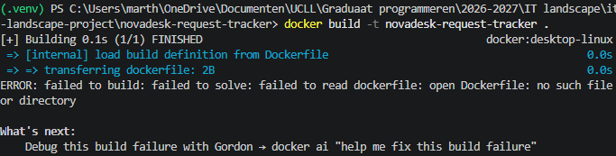
- dockerfile van de powerpoint gekopieerd en gevraagd aan copilot (in VS code) om mij te helpen dit aan te passen naar mijn huidige project 
- docker build en run uitgevoerd 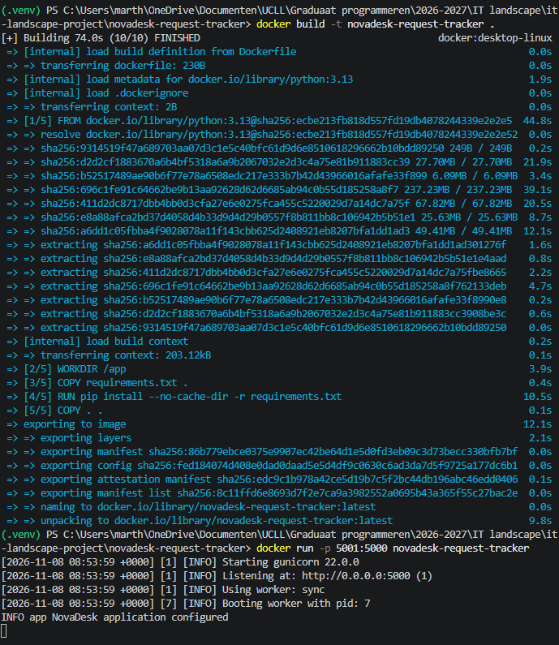
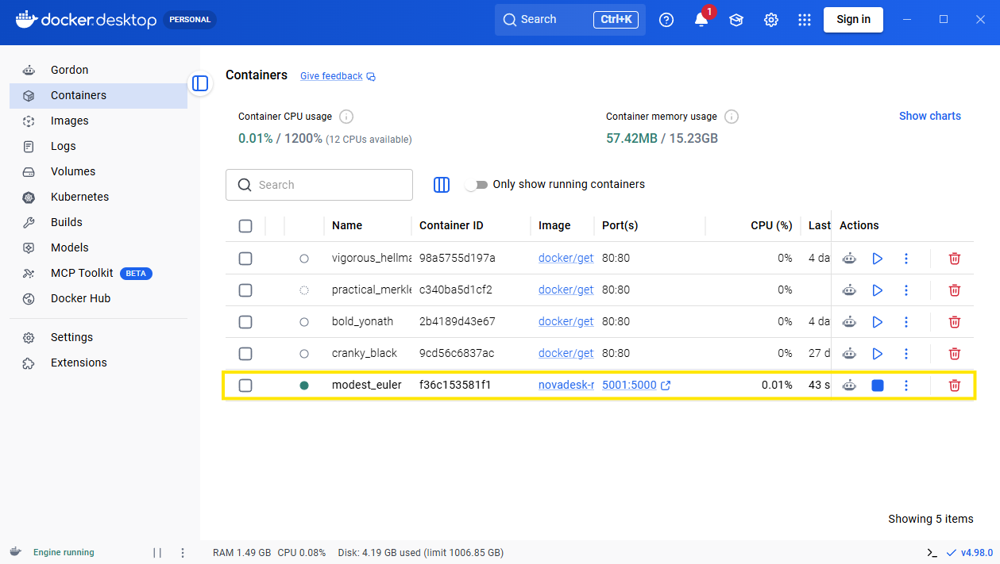
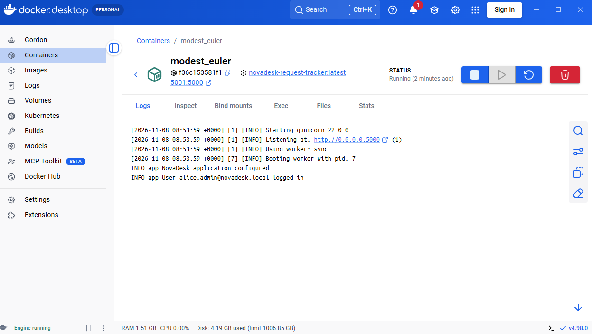
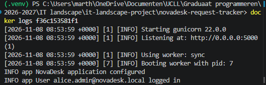
- applicatie via docker: 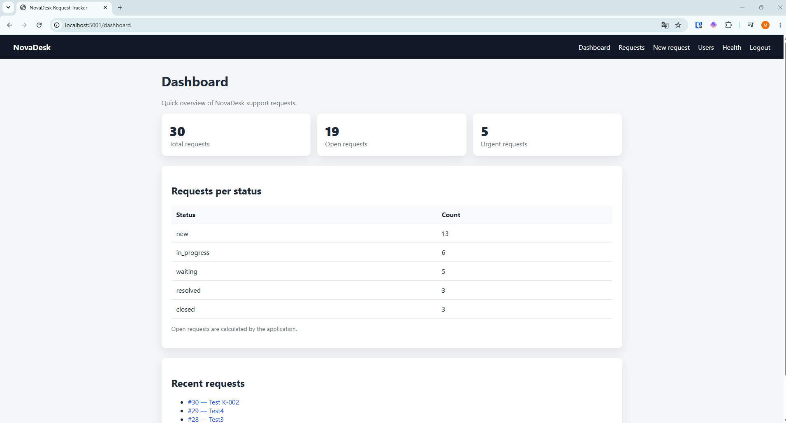

# Docker compose
- er is geen configuratiefile gevonden: 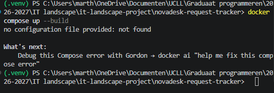
- docker-composefile van de powerpoint gekopieerd en gevraagd aan copilot (in VS code) om mij te helpen dit aan te passen naar mijn huidige project 
- docker compose up --build uitgevoerd 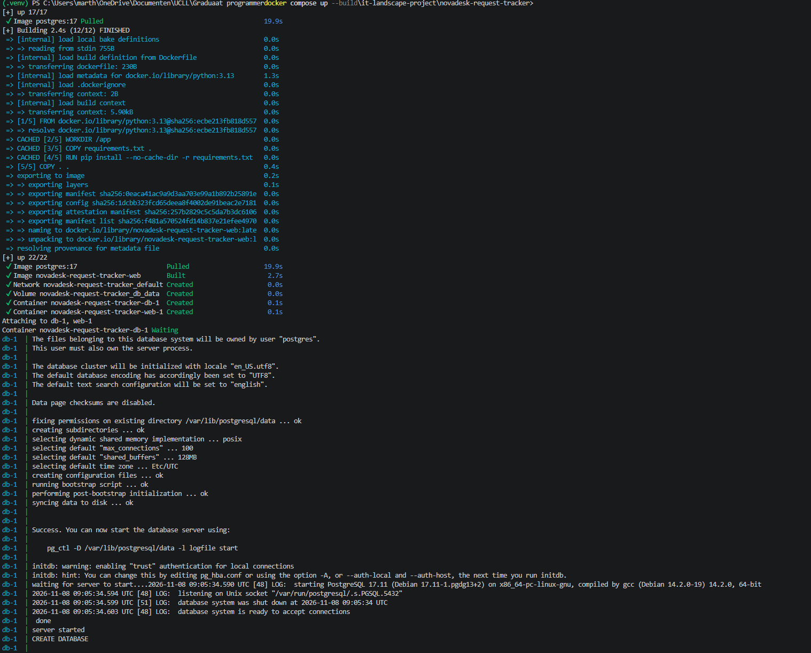
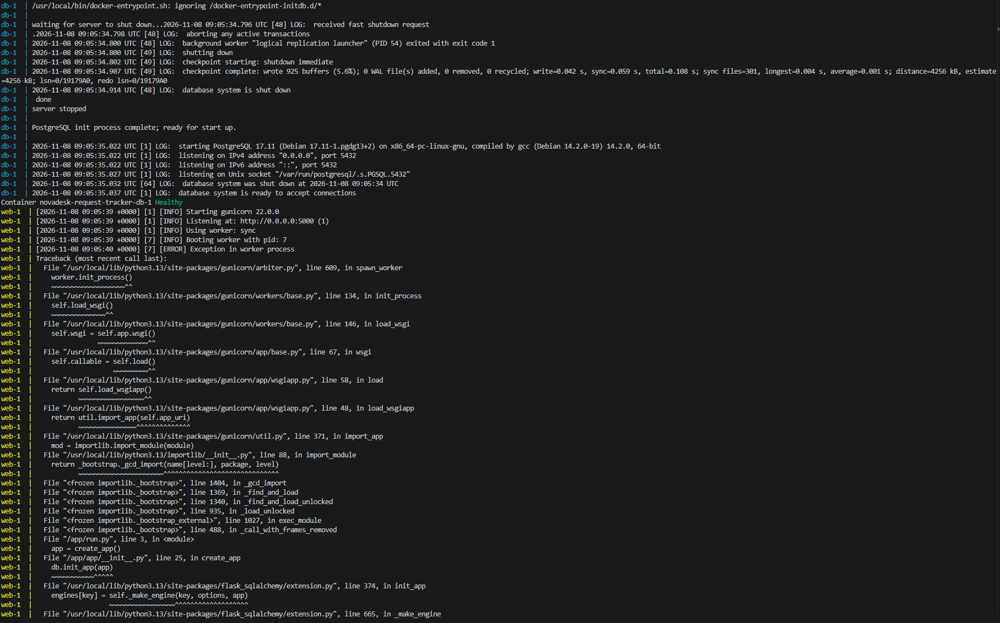
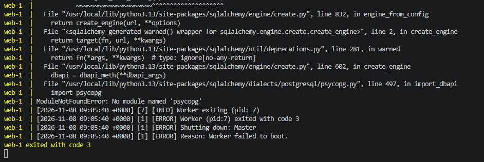
- dit is niet helemaal goed gegaan. Ik krijg een foutmelding over 'psycopg' in mijn DATABASE_URL. Ik probeer een keer om dit uit de URL te halen en dezelfde als in de powerpoint te gebruiken, maar dit werkt ook niet.
- ik zoek in de officiële documentatie van Docker naar een duidelijk voorbeeld of oplossing https://docs.docker.com/compose/gettingstarted/
- de documentatie helpt me niet echt verder. Ik vraag opnieuw hulp aan copilot. 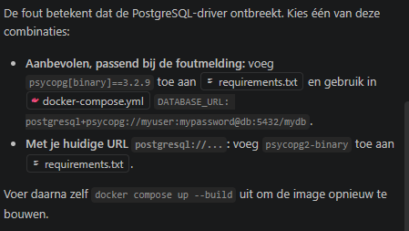
- dit werkt wel 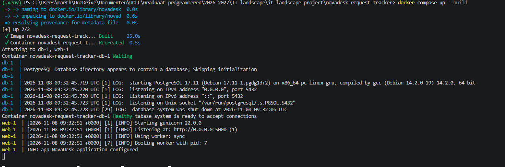
- nu krijg ik een internal server error 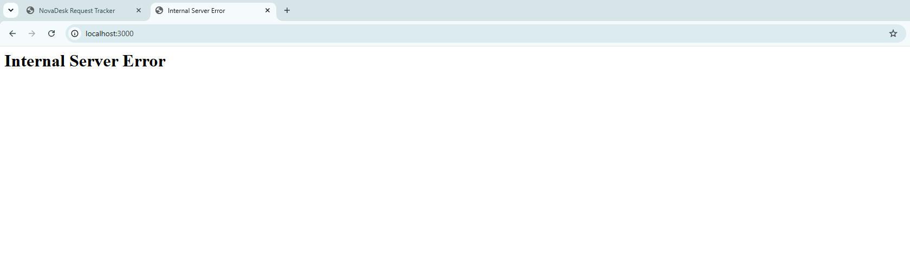
- ik ben vergeten om seed.py uit te voeren, dus voer ik dit uit: docker compose run --rm web python seed.py en nu werkt het wel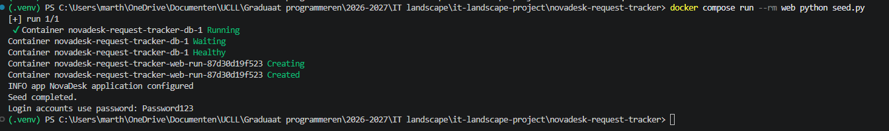 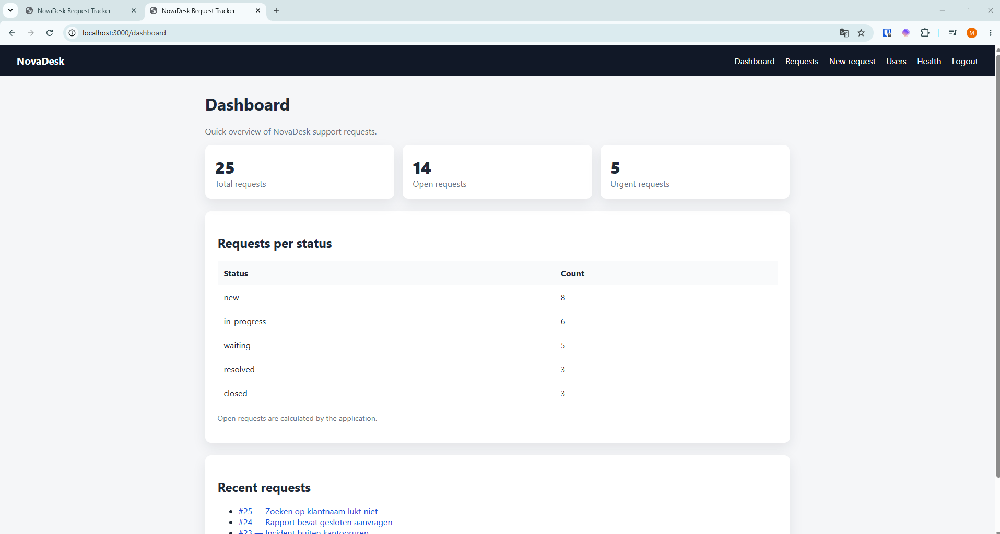
- het eerste wat opvalt is dat de requests die ik heb aangemaakt voor mijn tests voor de gebruikersklachten, verdwenen zijn. Deze waren er wel lokaal en via dockerfile. 
- Docker Compose kan dus in een teamcontext zeker nuttig zijn, omdat iedereen dan dezelfde versie heeft. Als je lokaal draait of via dockerfile, kunnen aanpassingen wel lokaal gebeuren, maar zijn ze niet met iedereen gedeeld 
- docker compose down uitgevoerd 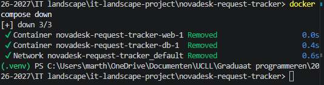

# Vergelijking
- Lokaal zonder Docker: gaat snel en makkelijk voor development, maar hier zal je heel snel het "het werkt op mijn machine"-scenario meemaken
- Via Dockerfile: dit gaat via een container die overal op dezelfde manier draait, dus iets minder gevoelig voor "het werkt op mijn machine". Het is wel beperkt, aangezien mijn nieuw aangemaakte requests daar wel nog in staan, en het dus mijn lokale versie gebruikt. 
- Via Docker Compose: één configuratiebestand met één commando dat voor iedereen hetzelfde resultaat geeft, inclusief database. Het vraagt wat meer installatiewerk, maar is wel de minst foutgevoelige optie voor teams. 