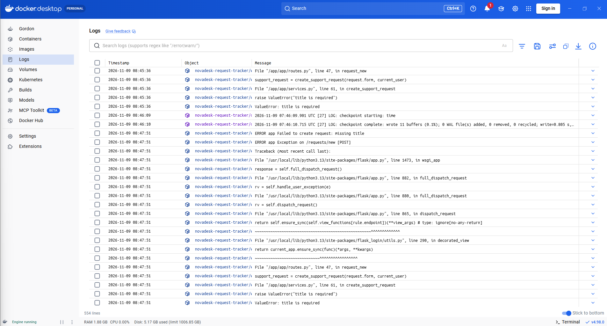
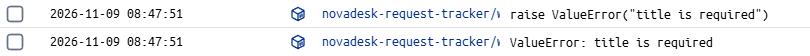
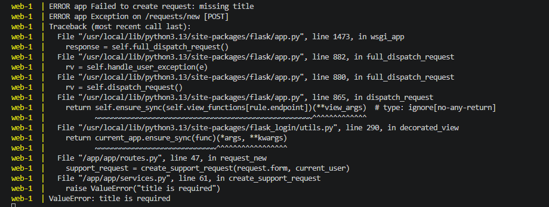
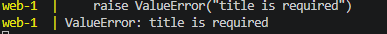
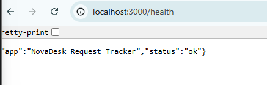

# Foutscenario
 - Ik verzend een leeg formulier. Ik zie de volgende logs:
 - in docker: 
 Het relevante deel hier is vooral 
 - in VS Code: 
 Hier is het relevante deel vooral 
 - Hieruit kan ik afleiden dat 'title' een required veld is. Ik heb niets ingevuld in het hele formulier, maar de controle stopt al wanneer de titel niet is ingevuld. 

 ## Klacht
 K-001 - Leeg formulier geeft technische foutmelding 
 https://github.com/MartheVerelstUCLL/it-landscape-project/issues/1#issue-6261288591

 ## Alertregel
 Een melding als 'Titel is een verplicht veld' zou nuttig zijn voor de gebruiker om te weten wat die fout deed.

 # Endpoints
 ## /health
 
 - Health toont een JSON waarin staat dat de status van de app ok is. De app is dus operationeel en draait op mijn computer. 
 - Dit endpoint controleert dus puur of de app bereikbaar is.
 - Het controleert geen enkele andere functionaliteit, bijvoorbeeld of de connectie met de database in orde is, of users kunnen inloggen. 
 - Dit is belangrijk voor support omdat het een eerste controle is die aangeeft dat de app bereikbaar is. Hiermee kan je de monitoring automatiseren zodat het systeem een melding geeft als de status niet ok is, eventueel automatisch de container te stoppen en opnieuw te starten en als er een melding binnenkomt dat er een probleem is met de app, kan dit de eerste check zijn om zeker te weten dat de server zelf niet gecrasht is.