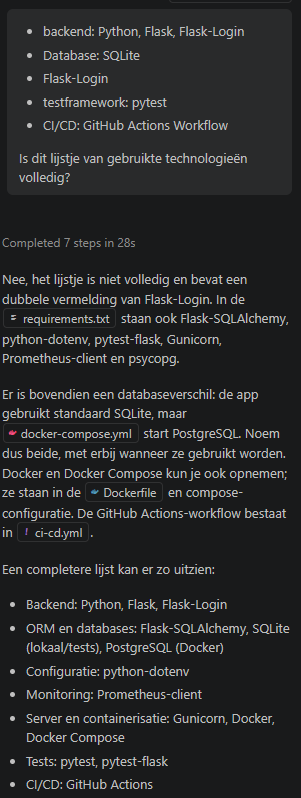

# AI gebruik en reflectie 

## APPLICATIEVERKENNING
- Ik heb gevraagd aan GitHub Copilot om in de files het wachtwoord om in de applicatie te geraken te zoeken. Die gaf aan dat het Password123 moet zijn. 
- Ik heb Gemini gebruikt om mij te helpen met de setup. Ik kreeg mooi de stappen terug voor Windows en heb deze gebruikt voor de README. 

## README
- Gebruikte technologieën: hierbij heb ik AI een mooi overzicht laten maken van alle technologieën die gebruikt zijn. 
- Projectstructuur laten uittekenen en in README laten plaatsen 
- Commands voor Linux gestructureerd laten uitschrijven
- De nodige informatie voor environment variables laten opzoeken en structureren, idem voor database en seed data 
- Gevraagd om mijn volledige README na te kijken en de voorgestelde verbeteringen (voornamelijk typfouten, iets betere zinnen) geaccepteerd 

## USER MANUAL
- Eerst de user manual zelf geschreven, daarna gevraagd aan Copilot om mijn tekst na te kijken. Copilot haalde er nog enkele fouten en onduidelijkheden uit. Ik had bijvoorbeeld de user roles niet helemaal juist beschreven. 
- Tijdens het schrijven aan Copilot gevraagd of die ergens kon vinden wat de verschillende statussen exact betekenen. Dat was niet zo, dus heb ik er zelf een logische invulling aan gegeven. 

## ALGEMEEN
- Alle .md files laten nakijken op fouten. Hierna kon ik nog enkele fouten aanpassen, zowel inhoudelijke onnauwkeurigheden als typfouten. Copilot heeft voor mij ook de juiste videobestanden gelinkt in de Analyse van de gebruikersklachten. 

## REFLECTIE 
Behalve voor de applicatiesetup heb ik alles met de geïntegreerde GitHub Copilot gedaan. 
AI is een heel handig hulpmiddel voor het opzoeken van informatie en structureren van tekst. De informatie die ik terugkreeg, was meestal correct en behulpzaam. 