# User Manual - NovaDesk Request Tracker
Welkom bij de gebruikershandleiding van de NovaDesk Request Tracker. NovaDesk Request Tracker is een applicatie waarmee we klant- en supportaanvragen kunnen registreren en opvolgen. Aanvragen worden ingedeeld in categorieën (sales, general, technical en billing), krijgen een prioriteit (low tot urgent) en een status. 

## Waarvoor dient de applicatie?
NovaDesk is een intern ticketsysteem. Het helpt medewerkers en support om klantaanvragen efficiënt te registreren en op te volgen. Hierbij kan het gaan om een technische vraag, een facturatieprobleem, een salesverzoek of andere vragen. Alles wordt centraal bijgehouden met een duidelijke status, categorie en prioriteit. 

## Hoe meld je je aan?
Om NovaDesk te kunnen gebruiken, heb je een account nodig.
1. Ga naar NovaDesk. Je ziet eerst een loginscherm. 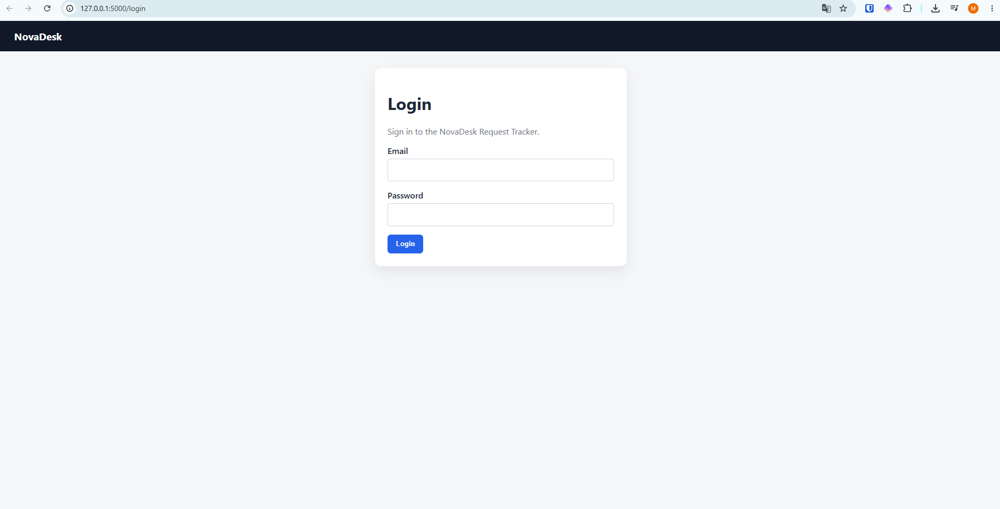
2. Meld je aan met je e-mailadres en bijbehorend wachtwoord 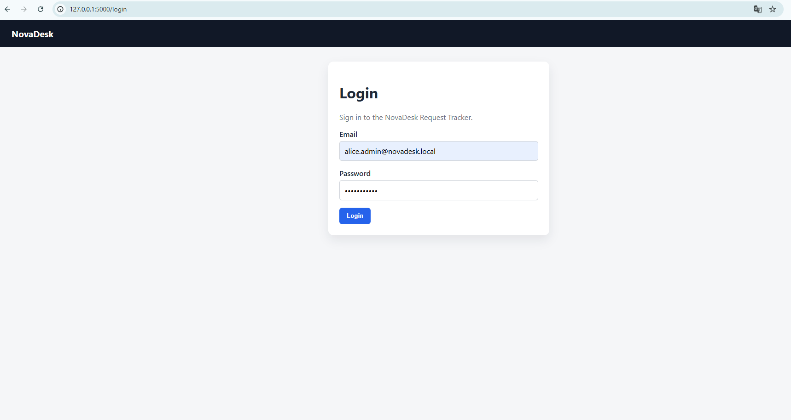
3. Klik op 'Login'.
4. Proficiat! Je bent aangemeld.

Heb je nog geen account? Vraag dan aan je leidinggevende om er een voor je aan te vragen. 

## Welke rollen zijn er?
Afhankelijk van je functie krijg je een bepaalde rol toegewezen. 
| Rol | Betekenis |
| --- | --- |
| Admin | Heeft volledige toegang tot alle aanvragen.|
| Agent/Support | Kan nieuwe aanvragen maken, de status en prioriteiten aanpassen, reacties toevoegen en toewijzingen beheren. Kan geen gebruikers beheren. |
| Viewer | Kan aanvragen en details bekijken, maar geen wijzigingen aanbrengen. |

## Hoe bekijk ik een aanvraag? 
- Zodra je ingelogd bent, kom je bij het Dashboard. Dit is de overzichtspagina. 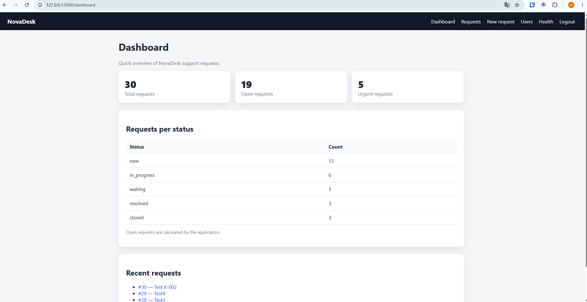
Je ziet hier in één oogopslag hoeveel requests er zijn, hoeveel er openstaan en hoeveel er dringend zijn. Open requests zijn enkel de requests in status 'new' en 'in progress'. 
- Onderaan de pagina zie je recente aanvragen. Je kan hierop klikken om een van de meest recente issues in detail te bekijken.
- Via 'Requests' rechtsboven kom je bij een lijst van alle requests. 

## Hoe maak ik een nieuwe aanvraag?
1. Klik op 'New request' rechtsboven in de balk of op de overzichtspagina 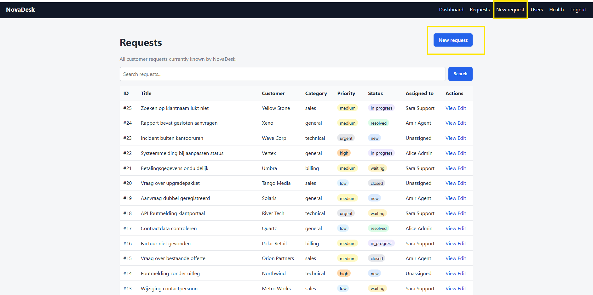
2. Vul je formulier in. Zorg ervoor dat je zeker een titel en categorie hebt aangeduid, maar bij voorkeur vul je alle velden behalve 'assigned to' in. 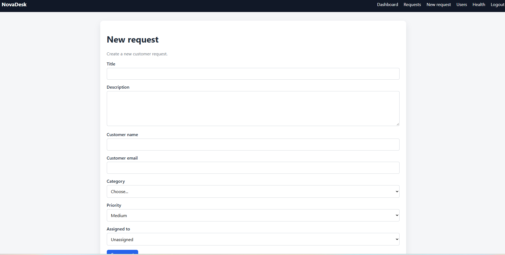
3. Klik onderaan op 'Save request'. Proficiat, je request is aangemaakt! 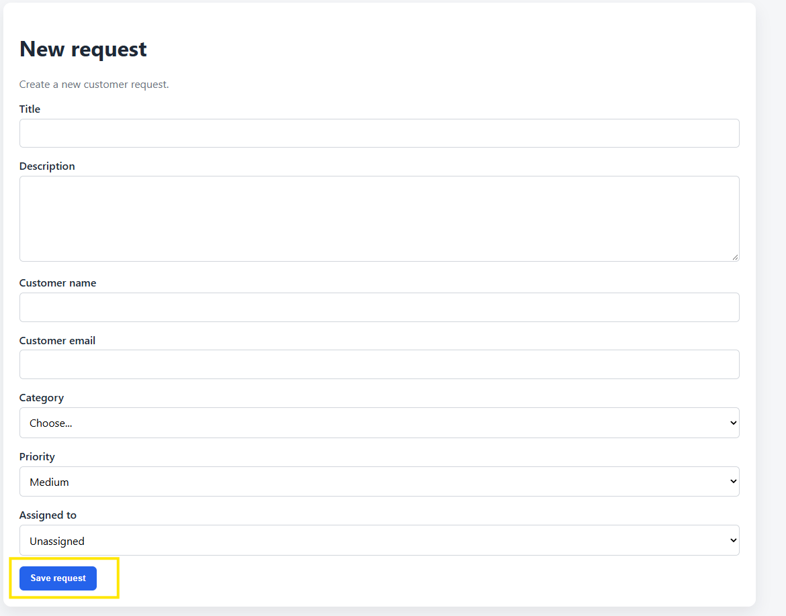

## Hoe zoek ik aanvragen?
1. Ga naar de overzichtspagina ('Requests' rechtsboven in je balk)
2. Tik je gewenste zoekterm in en druk op enter of klik op 'Search'. **Opgelet** Je kan momenteel enkel zoeken op titel en de zoekfunctie is hoofdlettergevoelig. 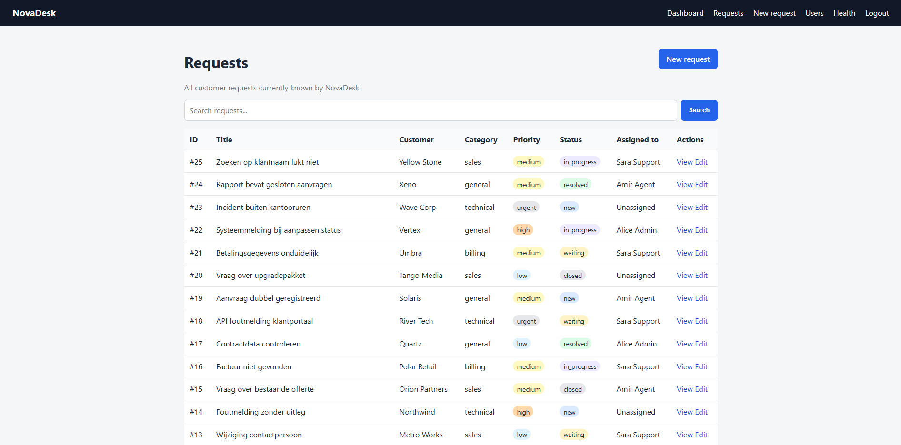 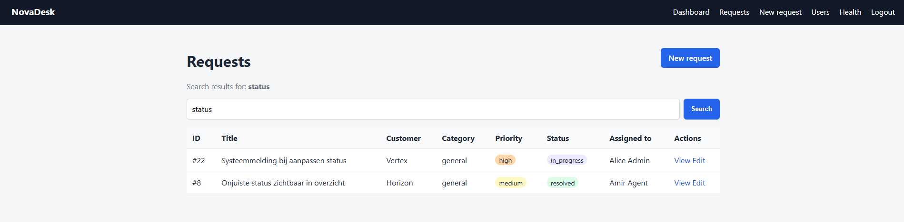

## Hoe interpreteer ik statussen en prioriteiten?
### Statussen 
| Status | Betekenis |
| --- | --- |
| New | De aanvraag is ingediend, maar nog niet in behandeling. |
| In progress | De aanvraag is in behandeling, er wordt aan gewerkt door een medewerker. |
| Waiting | De aanvraag is in behandeling, maar er ontbreekt nog informatie die opgevraagd is, of er is een andere reden waarom er momenteel niet aan verdergewerkt kan worden. |
| Resolved | De aanvraag is opgelost. **Opgelet** Deze status kan momenteel niet gebruikt worden.|
| Closed | De aanvraag is afgesloten. | 

### Prioriteiten 
| Prioriteit | Betekenis |
| --- | --- |
| Low | Dit issue moet bekeken worden, maar is helemaal niet dringend. Het gaat eerder om verbeteringen of suggesties. Deze issues worden op normale snelheid opgenomen. |
| Medium | Dit issue geeft moeilijkheden of problemen, maar we kunnen verder zonder dat het werk echt gehinderd wordt. Deze issues worden op normale snelheid opgenomen, voor de issues met lage prioriteit.|
| High | Dit issue geeft moeilijkheden of problemen die het werk belemmeren. Het is belangrijk dat hier snel naar gekeken wordt. Deze issues worden snel opgenomen.|
| Urgent | Dit issue veroorzaakt storingen en moet zo snel mogelijk opgelost worden. Deze issues worden onmiddellijk bekeken. |

## Wat doe ik bij een foutmelding?
**Bekende foutmeldingen**
- HTTP 500 bij verzenden van het formulier: kijk na of je 'title' en 'category' hebt ingevuld. Dit zijn verplichte velden. Vul deze in en probeer het daarna opnieuw.
- Pagina laadt niet: probeer het opnieuw, log eens opnieuw in en contacteer de servicedesk als het daarna nog niet laadt. 

**Nieuwe foutmeldingen**
- Maak bij voorkeur een ticket aan in NovaDesk.
- Kan je dit niet, vraag dan aan een collega om het voor jou te doen. 

## Waar vraag ik om hulp?
Loop je tegen hardnekkige problemen aan of ben je je wachtwoord kwijt? Neem dan contact op met de interne IT-helpdesk via support@NovaDesk.local. 

## Belangrijkste schermen 
- Login: 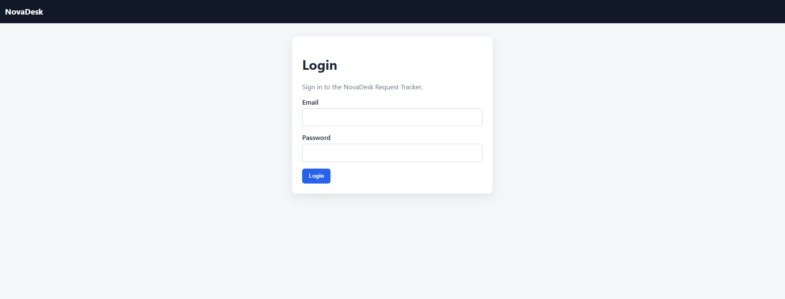
- Dashboard: 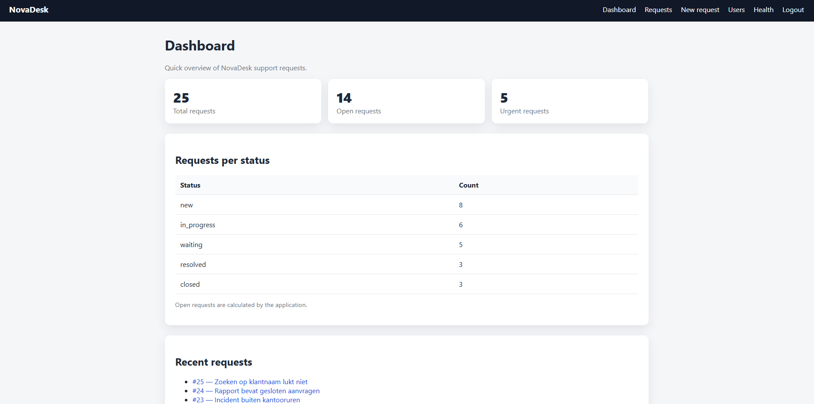
- Requests: 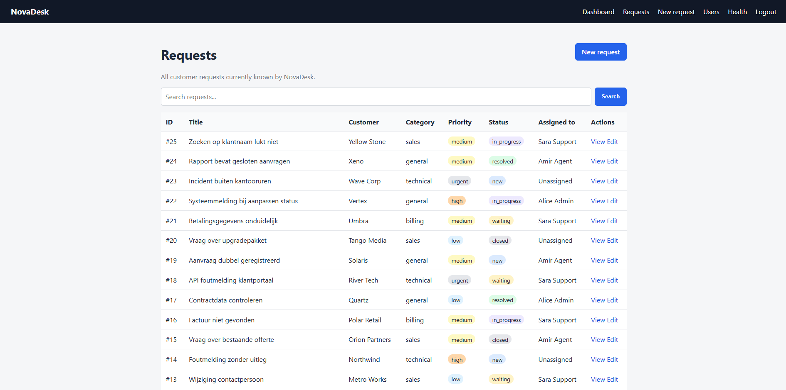
- Nieuw request: 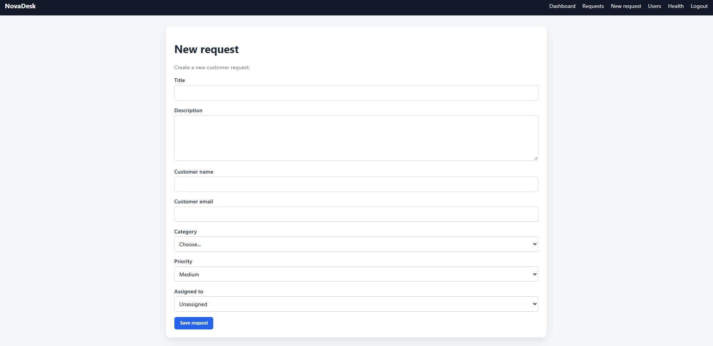