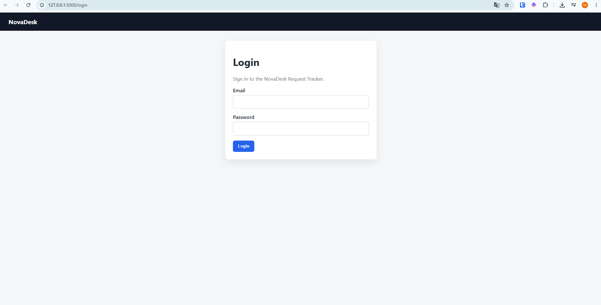
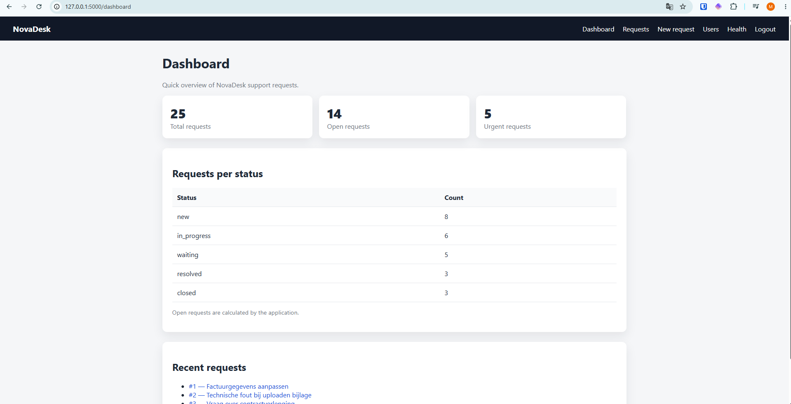
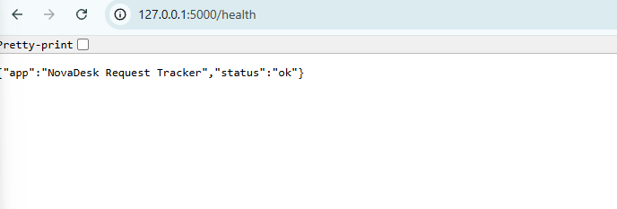

# Repository opstarten
- Repository aangemaakt in GitHub, public zodat het toegankelijk is voor de docent, verder de standaardinstellingen behouden
- Repository gecloned in VS Code
- De bestanden uit de ZIP-file toegevoegd aan het project in VS Code
- Initial commit gemaakt met de bestaande files

# Virtual environment aanmaken
- De instructies in de README zijn erg onduidelijk, zeker aangezien ik op Windows werk. Ik heb aan Gemini gevraagd hoe ik dit op Windows moet doen en die instructies overgenomen. Deze instructies heb ik gevogld om mijn virtual environment aan te maken, de dependencies te installeren en de database/seed data te initialiseren. 
## Copy-paste van Gemini: 
" Om deze Linux/macOS terminal-commando's uit te voeren op **Windows**, gebruik je de **Opdrachtprompt (Command Prompt)** of **PowerShell**.

Hieronder staat de exacte vertaling van de stappen voor Windows.

---

### Stappenplan voor Windows

1. **Open de map in de terminal:** Navigeer naar je projectmap.
Open **Command Prompt** (cmd) of **PowerShell**, en ga naar de map van je project met het commando `cd`:

```cmd
cd pad\naar\je\projectmap

```


2. **Virtuele omgeving aanmaken:**
Maak de virtuele omgeving aan met `python` i.p.v. `python3`:

```cmd
python -m venv .venv

```


3. **Virtuele omgeving activeren:**
Het activeringsscript bevindt zich op Windows in een andere map (`Scripts` in plaats van `bin`).

* **In Command Prompt (cmd):**

```cmd
.venv\Scripts\activate.bat

```

* **In PowerShell:**

```powershell
.venv\Scripts\Activate.ps1

```

*(Krijg je een foutmelding in PowerShell over uitvoeringsbeleid? Voer dan eerst `Set-ExecutionPolicy -ExecutionPolicy RemoteSigned -Scope Process` uit).*

*Verificatie:* Je ziet nu `(.venv)` voor je regel in de terminal staan.


4. **Afhankelijkheden installeren:**
Installeer de pakketten uit je `requirements.txt`:

```cmd
pip install -r requirements.txt

```

*Verificatie:* De packages worden gedownload en geïnstalleerd zonder rode foutmeldingen.


5. **Database vullen (Seeden):**
Voer het seed-script uit:

```cmd
python seed.py

```


6. **Start de Flask-applicatie:**
Zet de Flask-omgevingsvariabele (optioneel, handig voor Windows) en start de server:

```cmd
set FLASK_APP=app.py    (of de naam van je hoofdbestand, optioneel)
flask run

```

*Verificatie:* Je ziet de server draaien op `[http://127.0.0.1:5000](http://127.0.0.1:5000)`.
"

- Ik moest nog een nieuwe versie van pip installeren met python.exe -m pip install --upgrade pip
- Na installaties krijg ik dit beeld wanneer ik ga naar http://127.0.0.1:5000 
- Het wachtwoord is onbekend ('Vraag maar aan Wim')
- Ik heb gevonden dat het wachtwoord Password123 is en ingelogd met alice.admin@novadesk.local 

## Omgevingsvariabelen
- De omgevingsvariabelen zijn te vinden in env.example: FLASK_APP=run.py
FLASK_ENV=development
SECRET_KEY=
DATABASE_URL=sqlite:///novadesk.db


# Eerste observaties in de app
- Ik zie een dashboard met de support requests.
- De requests zelf zijn geordend volgens ID, het is redelijk onoverzichtelijk
- Het formulier om een nieuw request te maekn ziet er op het eerste gezicht helder uit 
- Ik zie de users maar kan ze niet bewerken
- Health lijkt niet te werken 


# AI
- Ik heb gevraagd aan GitHub Copilot om in de files het wachtwoord om in de applicatie te geraken te zoeken
- Ik heb Gemini gebruikt om mij te helpen met de setup