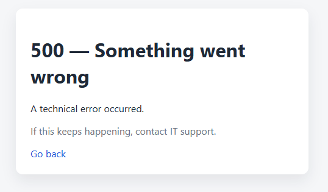
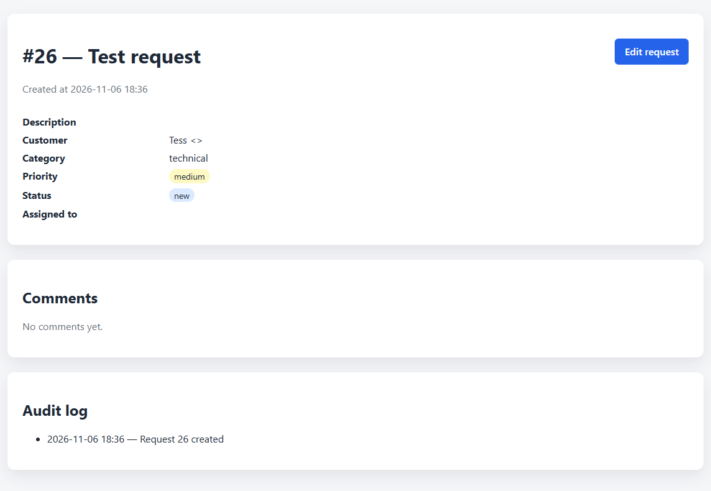
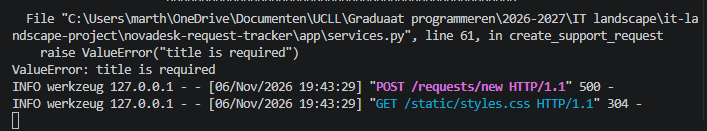
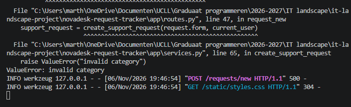
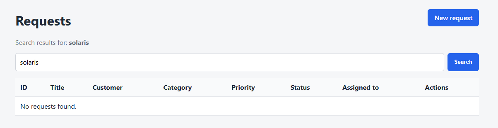
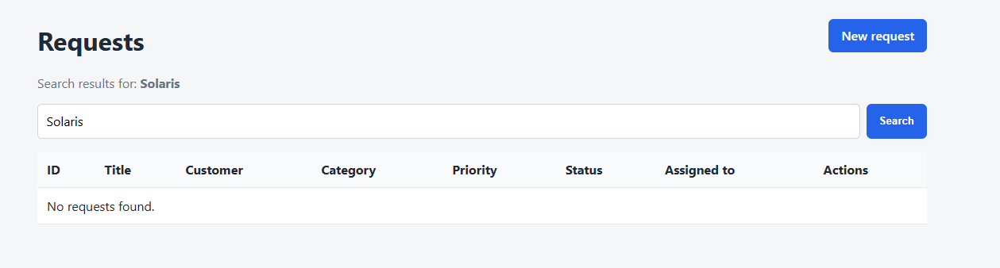
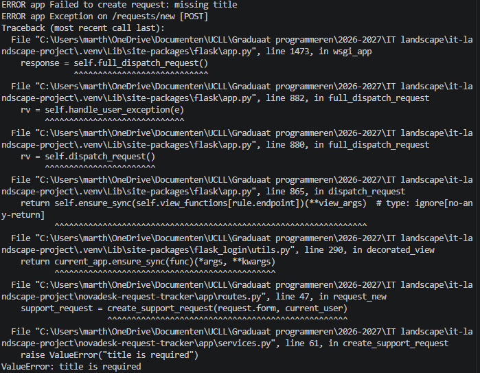

# Functionele of technische bugs

## oorspronkelijke klacht
K-001 — Leeg formulier geeft technische foutmelding
## type melding
Technische bug
### onderzochte stappen
- formulier volledig leeggelaten -> geeft foutmelding. Dit lijkt oké, aangezien we met een volledig leeg formulier niets kunnen doen. 
- formulier ingevuld met enkele velden leeg (description, customer email) -> request lukt 
- formulier ingevuld met enkel titel ingevuld -> zelfde foutmelding als leeg formulier
- na verschillende combinaties te testen: het lijkt erop dat minstens 'titel' en 'categorie' ingevuld moeten zijn 
### verwacht gedrag
- foutmelding bij het niet invullen van verplichte velden met daarbij aangeduid welke velden verplicht zijn, bijvoorbeeld de verplichte velden in het rood aangeduid
### effectief gedrag
- als 'titel' en 'categorie' niet ingevuld zijn, krijg je een technische foutmelding: 500 - Something went wrong 
### bewijsstukken
- 
- <video controls src="docs\K-001 leeg formulier.mp4" title="Title"></video>
- 
- 
### reproduceerbaarheid
- altijd reproduceerbaar: laat 'titel' en/of 'categorie' leeg 
### impact
- hoog: gebruikers weten niet wat ze fout gedaan hebben wanneer ze geen duidelijke foutmelding krijgen
### prioriteit
- hoog 
### gekoppelde GitHub Issue
https://github.com/MartheVerelstUCLL/it-landscape-project/issues/1
### conclusie
- serverside validatie ontbreekt of is niet duidelijk genoeg, er moet een duidelijke foutmelding voorzien worden voor wanneer verplichte velden niet ingevuld zijn  

## oorspronkelijke klacht
K-003 - Zoekfunctie geeft vreemde resultaten
### type melding
Functionele bug
### onderzochte stappen
- bestaande klantnaam solaris/Solaris geeft geen resultaat  
- meerdere klantnamen ingetikt, niets geeeft het gewenste resultaat
### verwacht gedrag
- zoekfunctie is niet hoofdlettergevoelig en zoekt in alle relevante velden (titel, klantnaam, eventueel ook categorie, prioriteit, status, assigned to)
### effectief gedrag
- zoekfunctie zoekt enkel in titel en is hoofdlettergevoelig
### bewijsstukken
<video controls src="docs\K-003 Zoekfunctie.mp4" title="Title"></video>

### reproduceerbaarheid
- altijd reproduceerbaar: tik klantnaam in en enter, tik vervolgens woord uit titel in en enter
### impact
- medium: gebruikers verliezen tijd doordat ze niet makkelijk kunnen zoeken 
### prioriteit
- medium: de app werkt wel en de requests zijn zichtbaar, maar het zoeken is niet betrouwbaar 
### gekoppelde GitHub Issue
https://github.com/MartheVerelstUCLL/it-landscape-project/issues/2 
### conclusie
- de zoekfunctie is afhankelijk van een exacte match en hoofdlettergevoelig en zoekt enkel in de titel. Dit zou aangepast moeten worden naar niet hoofdlettergevoelig en zoeken in minstens de titel en klantnaam. 

# Usability- of documentatieprobleem

## oorspronkelijke klacht
K-002 Onzeker of nieuwe aanvraag bewaard werd
### type melding
Usability 
### onderzochte stappen
- request aangemaakt en opgeslagen
### verwacht gedrag
- user ziet een bevestiging dat de request correct is geregistreerd
### effectief gedrag
- user komt weer op het overzichtscherm. De net aangemaakte request staat bovenaan maar er is geen duidelijk bevestiging
### bewijsstukken
- <video controls src="docs\K-002 bevestigingsmelding.mp4" title="Title"></video>
### reproduceerbaarheid
- altijd reproduceerbaar: maak een nieuw request aan 
### impact
- laag: requests worden wel opgeslagen, er kunnen hooguit requests dubbel aangemaakt worden 
### prioriteit
- laag 
### gekoppelde GitHub Issue
https://github.com/MartheVerelstUCLL/it-landscape-project/issues/3
### conclusie
- er wordt geen bevestiging getoond bij het aanmaken van een request

# Setup-, Docker-, logging- of monitoringsprobleem

## oorspronkelijke klacht
K-005 Moeilijk om logs te vinden bij fouten
### type melding
Loggingsprobleem
### onderzochte stappen
- actie uitvoeren die een fout veroorzaakt (in dit geval: formulier indienen zonder titel)
- terminaloutput bekijken tijdens lokale uitvoering 
### verwacht gedrag
- fouten worden gestructureerd en duidelijk gelogd met voldoende context (o.a. tijdstip, URL, exacte foutmelding)
### effectief gedrag
- fouten worden niet heel duidelijk weergegeven, er staat bijvoorbeeld geen tijdstip bij, geen gebruiker... 
### bewijsstukken
- 
- 
### reproduceerbaarheid
- altijd reproduceerbaar: trigger een foutmelding en kijk naar de logs
### impact
- hoog: het is moeilijker voor developers om de fout snel op te sporen 
### prioriteit
- hoog: essentieel voor support 
### gekoppelde GitHub Issue
https://github.com/MartheVerelstUCLL/it-landscape-project/issues/4
### conclusie
- er moet duidelijkere logging worden toegevoegd die exceptions opvangt met de timestamp en context erbij 

# Rechten-, rollen- of governanceprobleem

## oorspronkelijke klacht
K-004 - Viewer ziet knop die hij niet lijkt te mogen gebruiken
### type melding
Rechtenprobleem
### onderzochte stappen
- inloggen als Victor Viewer 
- op Edit klikken in het requestoverzicht
- op Edit klikken in details van een request ('View' -> 'Edit request')
### verwacht gedrag
- Victor is viewer en mag dus niets bewerken. Verwacht wordt dat Edit gedeactiveerd of onzichtbaar is en niet werkt.
### effectief gedrag
- Edit is klikbaar maar geeft een foutmelding 
### bewijsstukken
- <video controls src="docs\K-004 Viewer.mp4" title="Title"></video>
### reproduceerbaarheid
- Altijd wanneer ingelogd als viewer: klik op 'Edit' bij een request
### impact
- Medium: er is wel een foutmelding, maar dit kan nog steeds een risico zijn voor security 
### prioriteit
- Medium 
### gekoppelde GitHub Issue
https://github.com/MartheVerelstUCLL/it-landscape-project/issues/5
### conclusie
- Er ontbreekt logica om de Edit-knoppen te deactiveren of verbergen voor een Viewer. Deze zouden niet klikbaar mogen zijn. 