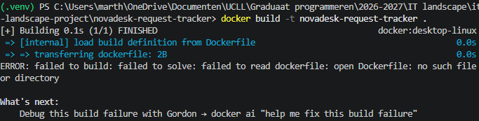
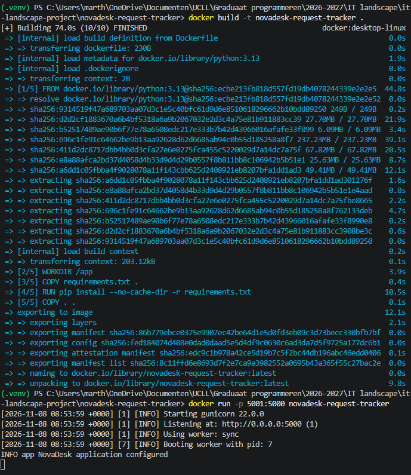
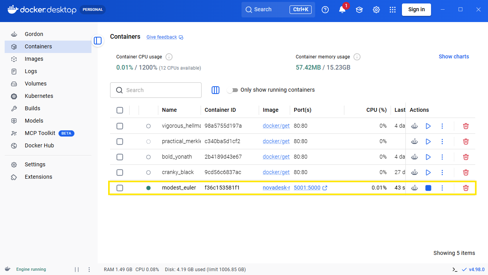
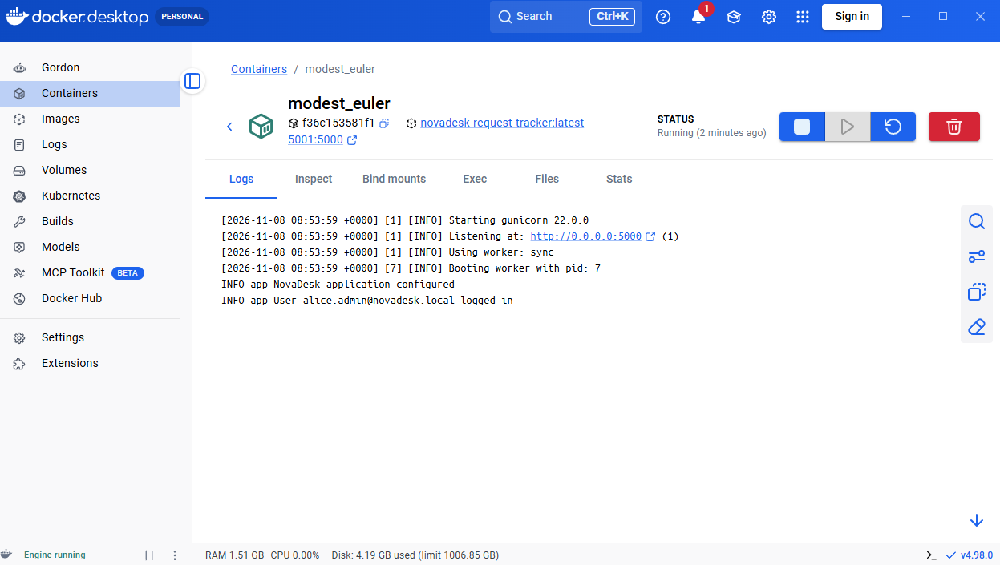
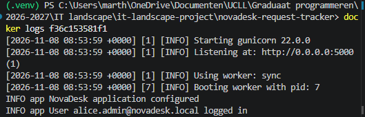
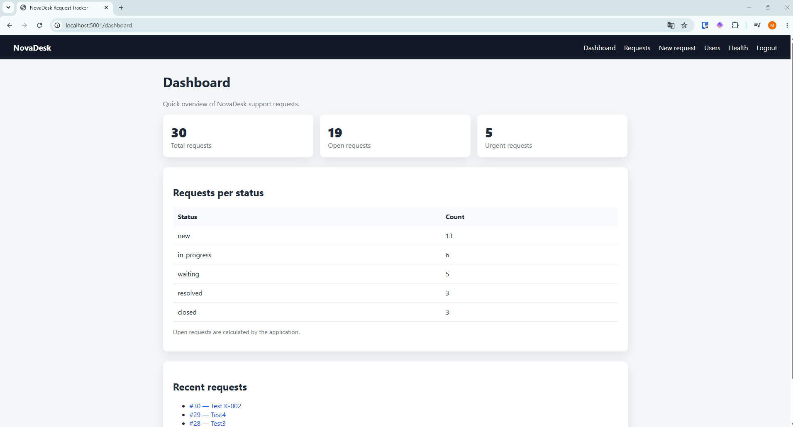

- docker build -t novadesk-request-tracker. geeft de volgende melding 
- dockerfile van de powerpoint gekopieerd en gevraagd aan copilot (in VS code) om dit aan te passen naar mijn huidige project 
- docker build en run uitgevoerd 

- applicatie via docker: 