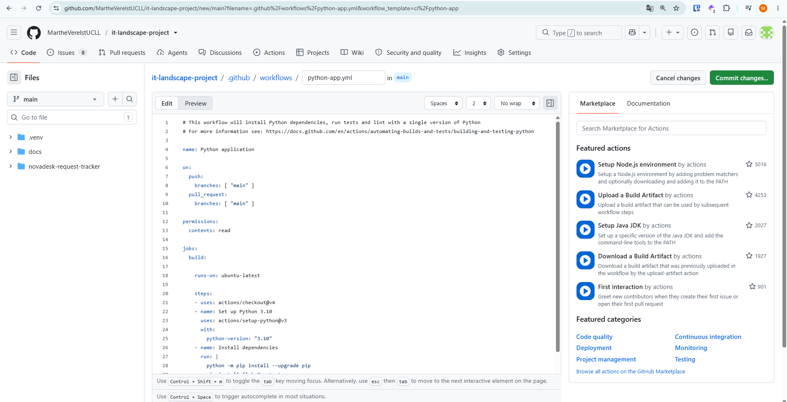
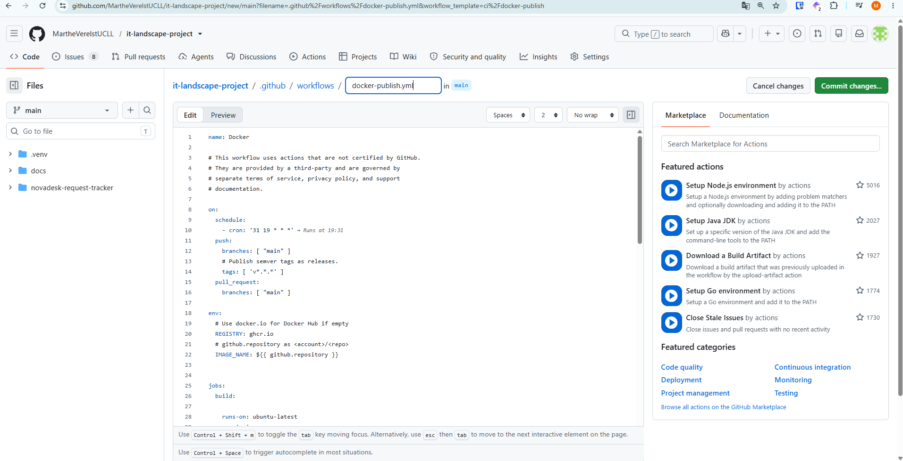
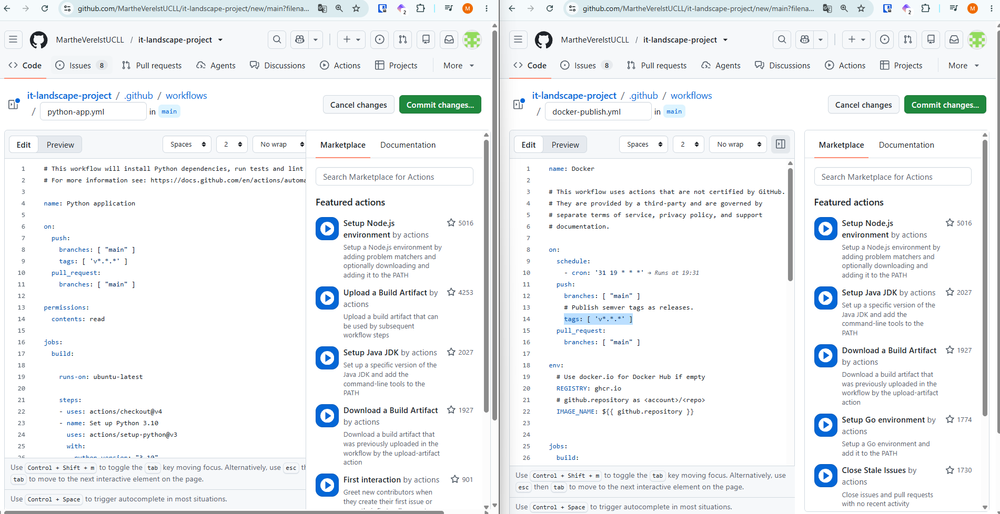
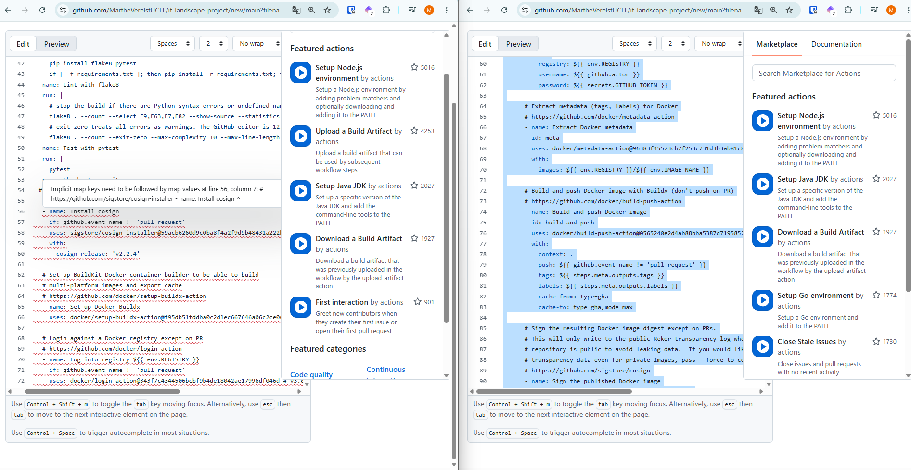
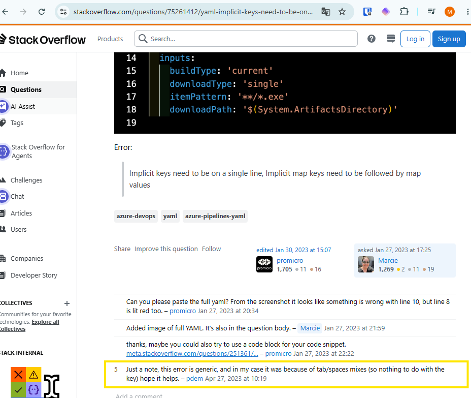
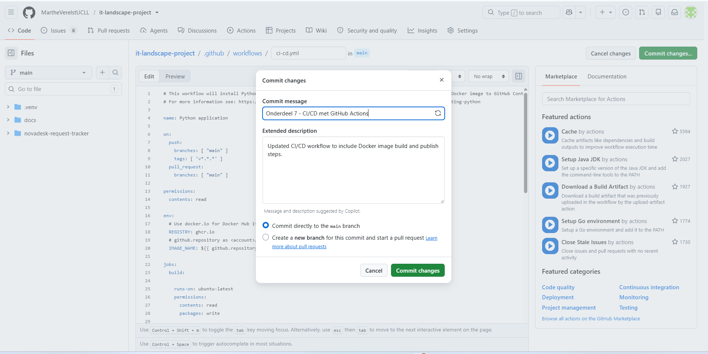

# CI CD met GitHub Actions 
- Ik weet niet zo goed hoe ik hieraan moet starten en vind niet meteen een voorbeeld in de documenten van de lessen. Ik ga naar de officiële documentatie op GitHub https://docs.github.com/en/actions/get-started/understand-github-actions
- Ik vind hier hoe ik de templates kan vinden en gebruiken https://docs.github.com/en/actions/how-tos/write-workflows/use-workflow-templates maar als ik de templates bekijk, lijkt het erop dat wat ik zoek er niet tussen zit
- Ik weet nu wel dat ik een map .github/workflows/ moet aanmaken, dus dat doe ik, en ik maak ook meteen een .yml bestand voor mijn pipeline
- Ik vind op GitHub ook templates voor Python en Docker, dus ik vraag me af of ik deze kan combineren. Ik prompt Copilot in VS code met "Kan je me helpen met een workflow? Ik moet minstens een repository ophalen, python installeren, dependencies intalleren, tests uitvoeren met pytest, een docker image bouwen en die docker image publceren naar een github container registry.

Ik heb templates gevonden voor python en docker. Kan ik deze combineren om te voldoen? Leg ook uit waarom wel/niet." en daaronder plak ik de templates die ik gevonden heb 
- Copilot zegt dat het kan: "Ja, je kunt deze templates combineren. Ze vullen elkaar aan: de Python-stappen testen de applicatie en de Docker-stappen bouwen en publiceren die pas daarna. Ik heb een gecombineerde workflow toegevoegd in ci-cd.yml, naast de Dockerfile en requirements.txt.

De workflow haalt de repository op, installeert Python 3.13 en de dependencies, en voert pytest uit. Daarna bouwt hij het image. Bij een pull request wordt het image alleen gebouwd, niet gepubliceerd; bij een push naar main of een versie-tag zoals v1.2.3 publiceert hij naar GHCR. Daarvoor geeft packages: write de workflow toegang en gebruikt hij GITHUB_TOKEN om in te loggen.

Ik heb de optionele cosign-ondertekening en geplande builds weggelaten: die zijn niet nodig voor je vereisten. Flake8 uit de Python-template kun je later eventueel toevoegen als lintstap.

Validatie: alle 15 tests slagen met python -m pytest tests/. Die gerichte opdracht is nodig omdat er ook een geneste, dubbele tests-map in de projectroot staat; een algemene pytest-run veroorzaakt daardoor importconflicten. Het YAML-bestand heeft geen gemelde fouten. De GHCR-publicatie zelf moet nog door GitHub Actions worden uitgevoerd; zorg dat de workflow op de juiste repository en branch staat."
Ik heb meteen ook de geneste map verwijderd, die hoorde daar niet te staan. 

- Ik heb nu wel een pipeline maar wil toch ook eens kijken of ik dat in GitHub zelf gedaan krijg. Ik open dus de twee templates opnieuw  en .
- Ik zet de twee naast elkaar  zodat ik ze kan vergelijken en samenvoegen. Copy-paste werkt tot een bepaald punt: 
- Ik ga toch maar eens kijken wat Copilot ervan gemaakt heeft en zie dat dit er veel simpeler uitziet: 
name: CI and Docker publish

on:
  push:
    branches: ["main"]
    tags: ["v*.*.*"]
  pull_request:
    branches: ["main"]

permissions:
  contents: read

env:
  REGISTRY: ghcr.io
  IMAGE_NAME: ${{ github.repository }}

jobs:
  test-and-publish:
    runs-on: ubuntu-latest
    permissions:
      contents: read
      packages: write

    steps:
      - name: Check out repository
        uses: actions/checkout@v4

      - name: Set up Python
        uses: actions/setup-python@v5
        with:
          python-version: "3.13"

      - name: Install dependencies
        run: |
          python -m pip install --upgrade pip
          python -m pip install -r requirements.txt

      - name: Run tests
        run: python -m pytest tests/

      - name: Set up Docker Buildx
        uses: docker/setup-buildx-action@v3

      - name: Log in to GitHub Container Registry
        if: github.event_name != 'pull_request'
        uses: docker/login-action@v3
        with:
          registry: ${{ env.REGISTRY }}
          username: ${{ github.actor }}
          password: ${{ secrets.GITHUB_TOKEN }}

      - name: Extract Docker metadata
        id: meta
        uses: docker/metadata-action@v5
        with:
          images: ${{ env.REGISTRY }}/${{ env.IMAGE_NAME }}

      - name: Build and publish Docker image
        uses: docker/build-push-action@v6
        with:
          context: .
          push: ${{ github.event_name != 'pull_request' }}
          tags: ${{ steps.meta.outputs.tags }}
          labels: ${{ steps.meta.outputs.labels }}
          cache-from: type=gha
          cache-to: type=gha,mode=max

- Ik vergelijk nu deze versie met mijn GitHub-fabricaat: 
    - ik verplaats de repository checkout naar boven
    - ik verander de python-version naar 3.13
    - ik zorg ervoor dat de juiste dependencies geïnstalleerd worden
    - de 'Lint with flake8' staat niet bij Copilot, dus ik zoek op wat dit juist is en vind GitHub documentatie: https://github.com/marketplace/actions/python-flake8-lint. Ik denk dat dat in mijn project niet gebruikt wordt en haal het eruit.
    - ik zet het juiste command voor pytest in de template 
    - ik kom nu aan de regel met de foutmelding, dus ik google wat die betekent en ik vind deze comment op Stack overflow  https://stackoverflow.com/questions/75261412/yaml-implicit-keys-need-to-be-on-a-single-line-implicit-map-keys-need-to-be-fol
    - ik zie dat de indentatie niet overal hetzelfde is en pas dat aan. Na een aantal keer op backspace te duwen voor de juiste regels, is de error opgelost 
    - ik verwijder ook het signen van de container, aangezien dat iets is wat we niet gezien hebben tot nu toe 
    - ik pas de commentaartekst bovenaan aan en kom nu hierbij:
    # This workflow will install Python, install dependencies, run tests, build a Docker image and publish the Docker image to GitHub Container Registry
# For more information see: https://docs.github.com/en/actions/automating-builds-and-tests/building-and-testing-python

name: Python application

on:
  push:
    branches: [ "main" ]
    tags: [ 'v*.*.*' ]
  pull_request:
    branches: [ "main" ]

permissions:
  contents: read

env:
  # Use docker.io for Docker Hub if empty
  REGISTRY: ghcr.io
  # github.repository as <account>/<repo>
  IMAGE_NAME: ${{ github.repository }}

jobs:
  build:

    runs-on: ubuntu-latest
    permissions:
      contents: read
      packages: write

    steps:
    - name: Check out repository
      uses: actions/checkout@v4
    - name: Set up Python 
      uses: actions/setup-python@v5
      with:
        python-version: "3.13"
    - name: Install dependencies
      run: |
        python -m pip install --upgrade pip
        pip install -r requirements.txt
    - name: Test with pytest
      run: python -m pytest tests/

      # Set up BuildKit Docker container builder to be able to build
      # multi-platform images and export cache
      # https://github.com/docker/setup-buildx-action
    - name: Set up Docker Buildx
      uses: docker/setup-buildx-action@v3

      # Login against a Docker registry except on PR
      # https://github.com/docker/login-action
    - name: Log into registry ${{ env.REGISTRY }}
      if: github.event_name != 'pull_request'
      uses: docker/login-action@343f7c4344506bcbf9b4de18042ae17996df046d # v3.0.0
      with:
        registry: ${{ env.REGISTRY }}
        username: ${{ github.actor }}
        password: ${{ secrets.GITHUB_TOKEN }}

      # Extract metadata (tags, labels) for Docker
      # https://github.com/docker/metadata-action
    - name: Extract Docker metadata
      id: meta
      uses: docker/metadata-action@96383f45573cb7f253c731d3b3ab81c87ef81934 # v5.0.0
      with:
        images: ${{ env.REGISTRY }}/${{ env.IMAGE_NAME }}

      # Build and push Docker image with Buildx (don't push on PR)
      # https://github.com/docker/build-push-action
    - name: Build and push Docker image
      id: build-and-push
      uses: docker/build-push-action@0565240e2d4ab88bba5387d719585280857ece09 # v5.0.0
      with:
         context: .
         push: ${{ github.event_name != 'pull_request' }}
         tags: ${{ steps.meta.outputs.tags }}
         labels: ${{ steps.meta.outputs.labels }}
         cache-from: type=gha
         cache-to: type=gha,mode=max

- ik wil natuurlijk liefst mijn versie gebruiken, dus verwijder ik het bestand dat Copilot voor mij gemaakt had en maak ik het aan via GitHub 
- ik commit via GitHub en gebruik pull om de workflow in VS Code te krijgen 
- nu zou een push naar main de workflow moeten triggeren, dus ik ga dit document pushen naar GitHub. 
